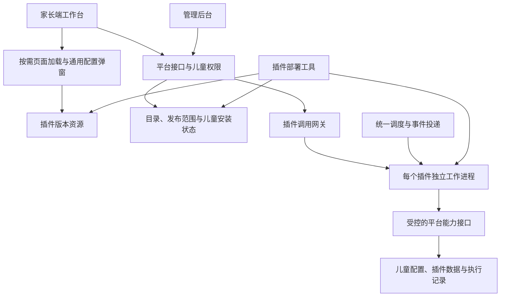

# 儿童成长工作台与插件系统设计

日期：2026-10-30（北京时间）
适用项目：乐乐成长
设计基线：`codex/plugin-mode`，业务代码提交 `ca95354`
状态：根据讨论整理的设计方案；尚未实现或部署。实施清单见 [实施方案](../plans/2026-10-30-plugin-workbench.md)。

## 1. 目标与已确认的决定

将当前项目发展为以儿童为单位的成长管理工作台。平台承载账号、儿童、权限和公共业务能力；插件扩展页面、配置和后台服务。家长选择安装和启用，管理员控制上架和可用范围，开发者按统一规范交付插件。

| 已确认事项 | 具体规则 |
| --- | --- |
| 配置归属 | 安装、启停、业务配置和菜单均归属儿童，同一儿童下的所有家长共享 |
| 插件类型 | 页面型启用后自动有顶部 Tab；后台型没有顶部 Tab，在应用管理中通过弹窗配置 |
| 顶部控制 | 不提供独立的“顶部展示”开关；页面型也允许包含后台任务 |
| 家长端入口 | 设置 → 应用管理，支持浏览、名称搜索、安装、卸载、启用、停用和配置 |
| 发布范围 | 全部儿童，或指定儿童；所有判断依据当前儿童 |
| 发布状态 | 仅待发布、已上架、已下架三个状态 |
| 新插件发布 | 代码部署后自动登记待发布，管理员完善信息和范围后上架 |
| 下架效果 | 所有已安装实例强制不可用，页面、接口和后台任务都受影响 |
| 加载条件 | 未安装或未启用时不主动加载插件业务代码，不执行业务任务 |
| 独立部署 | 同仓库开发，主系统和每个插件分别构建、版本化和部署 |
| 更新体验 | 允许目标插件短暂显示“更新中”；主系统及其他插件继续服务 |

### 本方案补齐的默认规则

以下是为使方案可执行而提出的默认设计，尚非用户逐项指定；后续可以调整，不阻塞本次方案整理。

1. 儿童负责人管理安装、卸载、启停和共享配置；其他家庭成员可以使用、查看状态。权限与配置的共享范围是两个概念。
2. 无必填配置的插件安装后启用；有必填配置的插件先安装为停用，完成配置并点击“保存并启用”后生效。
3. 家长端停用和卸载保留配置及历史数据；重新安装可恢复配置，但不自动开始后台工作。家长端第一版不提供独立清空历史数据按钮；管理员的平台级删除另按第 10.6 节执行。
4. 下架、被移出发布范围或儿童归档后，恢复资格需要负责人重新启用；正常版本更新成功后自动恢复更新前的启用意图。
5. 首期保留日历、积分商城、任务设置等现有核心功能；先用独立插件验证机制，后续再评估既有模块迁移。
6. 首期仅接入项目团队开发并随代码审查交付的插件；不开放家长上传任意插件包。
7. 首期每个插件全站只有一个活动版本；按儿童指定范围控制资格，不承诺不同儿童运行不同代码版本。

## 2. 参考系统与适用取舍

资料核对日期为 2026-10-30。下述“借鉴”属于本项目设计判断，不代表参考系统本身具备本项目的儿童隔离或零影响更新能力。

| 官方参考 | 可借鉴机制 | 本项目落点 |
| --- | --- | --- |
| [OpenWrt SDK](https://openwrt.org/docs/guide-developer/toolchain/using_the_sdk) | 针对指定系统版本单独构建软件包，无须重新构建整个系统 | 插件独立构建，声明兼容的平台协议版本 |
| [OpenWrt 软件包规范](https://openwrt.org/docs/guide-developer/package-policies) | 分别声明构建依赖与运行依赖 | 插件依赖锁定、运行环境检查、不可变发布包 |
| [OpenWrt UCI](https://openwrt.org/docs/guide-user/base-system/uci) | 集中管理配置，并将配置变化应用到服务 | 儿童级配置统一存储，配置修订驱动任务重排和实例刷新 |
| [OpenWrt procd](https://openwrt.org/docs/techref/procd)、[服务脚本](https://openwrt.org/docs/guide-developer/procd-init-scripts) | 明确服务生命周期、实例及重新加载机制 | 平台管理插件工作进程、健康检查、停止和失败恢复 |
| [Grafana 插件后端](https://grafana.com/developers/plugin-tools/key-concepts/backend-plugins/) | 插件后端作为独立子进程，通过协议通信，并提供健康检查 | 采用独立插件进程和稳定接口，使插件故障及更新限制在自身范围 |
| [Grafana 插件清单](https://grafana.com/developers/plugin-tools/reference/plugin-json) | 用清单声明标识、类型、入口、能力和兼容依赖 | `plugin.json` 是机器可验证的技术合同 |

OpenWrt 部分 Wiki 直连返回访问校验，本次通过搜索工具返回的官方页面索引内容核对 SDK、UCI、包规范和 procd 描述；Grafana 两份官方页面可直接读取。没有据此声称完成 OpenWrt 源码审计。

不直接引入路由器的软件包管理器：它管理设备上的软件；本项目需要额外区分“服务器已部署插件代码”和“某个儿童已安装插件”。也不照搬 Grafana 的 Go/gRPC 技术选型，本项目继续使用 Python，通过本机 Unix socket 上的 HTTP 协议通信。

独立发布不等于可以忽略兼容性。OpenWrt 官方 [apk 文档](https://openwrt.org/docs/guide-user/additional-software/apk) 同样提醒软件包更新需要考虑依赖和系统一致性。本项目必须在切换前检查平台协议、配置格式及数据兼容性。

## 3. 现状与改造边界

已检查的当前代码：

- `frontend/parent/src/App.tsx`：日历、积分商城和设置导航固定；商城、打印已有按需加载。
- `frontend/parent/src/lib/runtime.ts`：已有儿童切换、请求取消和过期响应隔离；导航类型是固定枚举。
- `frontend/parent/src/settings/index.tsx`：已有设置分组和详情区域，可新增应用管理。
- `frontend/admin/src/App.tsx`、`components/admin-layout.tsx`：后台目前主要为账号管理和个人资料。
- `backend/lele_growth/child_service.py`：会话认证、家长/管理员入口隔离、儿童成员权限、事务和审计已存在。
- `backend/lele_growth/accounts_app.py`：统一 API 入口和静态资源白名单；插件路径必须显式新增，不能扩大成任意文件访问。
- `scripts/package_release.py`、`scripts/release_assets.py`：现有发布将前后端整体打包，并验证资源依赖。
- `deploy/run.py`、`deploy/lele-growth@.service`：家长端与管理端为独立进程；本轮检查未发现可复用的统一插件任务执行器。

首次落地需要一次主系统发布和增量建表。此后插件只使用已支持的协议和平台能力时，可独立更新；需要新增平台能力或变更公共结构时，先更新平台。

## 4. 总体结构



平台职责：身份、儿童访问、安装状态、范围检查、配置、导航、能力接口、任务调度、审计和部署协调。插件职责：本插件的页面、业务计算、配置规则和任务处理。

Linux 运行三个平台服务：现有 parent、admin，以及新增的插件运行服务 plugin-runtime。plugin-runtime 管理工作进程、调度及内部能力网关；每个有后端能力且存在有效启用实例的插件拥有一个独立工作进程，服务多个儿童。纯前端插件不启动后端进程。

插件进程不在 parent/admin 进程内动态导入或热替换。主系统不因单插件更新而重启。工作进程采用独立虚拟环境和只读版本目录；平台共享调度器可以常驻，但未启用儿童不产生插件业务执行。部署期间允许在禁止业务的探测模式启动候选版本。

平台接口请求不能长时间持有现有儿童锁等待插件网络响应：先验证并取得带版本的调用上下文，退出事务，再调用插件；插件最终写入通过网关开启新事务，重新校验状态与版本。

## 5. 状态与生命周期

### 5.1 分开记录三类状态

| 层次 | 字段和值 | 用途 |
| --- | --- | --- |
| 发布 | `publication_status`: `pending/published/unpublished` | 对应待发布、已上架、已下架 |
| 儿童安装 | `installed`、`enabled`、`requires_reenable` | 表达家长的选择及强制失效后的恢复要求 |
| 全局运行 | `operation_state`: `ready/updating/failed` | 表达正常、更新中、运行异常，不是新的发布状态 |

平台级删除另记录 `retired_at`、`removed_at` 和清理作业状态，不新增第四种发布状态。`retired_at` 在删除请求正式受理时设置，立即禁止恢复运行；`removed_at` 只在选定清理范围核验完成后设置。

新登记记录是 `pending`；完成上架后是 `published`；下架后是 `unpublished`，允许重新上架，普通版本更新不把已有插件改回待发布。删除后的显式恢复是例外，需要重新登记待发布并由管理员重新上架。新版本准备失败只记录该版本失败；只要旧版本仍可运行，插件整体保持 `ready`。

统一生效条件：

```text
effective_enabled = 已上架
                 AND 未被平台删除或进入删除流程
                 AND 当前儿童在范围内
                 AND 儿童存在且未归档
                 AND 已安装且家长选择启用
                 AND 不需要重新启用
                 AND 配置通过校验
                 AND 存在兼容的活动版本
                 AND 运行状态正常
```

家长请求还必须通过账号、当前儿童成员资格和操作权限检查；后台任务依据儿童实例及服务能力授权运行，不依赖某位家长的登录会话。

页面型顶部入口依据“有资格且已安装启用的页面型插件”生成。更新中或暂时故障时保留入口，展示更新/故障占位页，不运行插件代码；主动停用、卸载、下架、范围收回时移除顶部入口。该规则避免更新时菜单来回跳动。

### 5.2 操作规则

| 操作 | 状态、页面及后台影响 | 数据处理 |
| --- | --- | --- |
| 首次安装 | 再检查资格；缺必要配置则安装为停用，否则可直接启用 | 创建儿童安装记录和默认配置 |
| 启用 | 检查配置、版本和范围；清除重新启用要求；按需加载/调度 | 保留已有配置及历史 |
| 停用 | 立即关闭新的业务请求、任务领取和效果提交；取消等待任务；清理页面 | 保留 |
| 卸载 | installed=false、enabled=false；generation 递增；旧任务失效 | 保留供重装恢复 |
| 重新安装 | 恢复配置并提示有历史记录；显式启用后运行 | 不重复初始化或创建重复任务 |
| 下架 | 全局资格即时失效；已安装记录标记 requires_reenable | 保留，已安装列表说明“平台已下架” |
| 范围收回 | 只使被移出儿童失效；该实例 requires_reenable | 保留，说明“当前儿童不在开放范围” |
| 重新上架/恢复范围 | 可以再次启用，后台工作不自动恢复 | 保留 |
| 更新代码 | 不改发布状态、范围、安装和 enabled 意图；目标插件暂时更新中 | 配置和数据继续归属原儿童 |
| 平台删除（保留数据） | 全部儿童不可使用；清理插件进程、任务、代码与部署资源 | 保留儿童配置和业务历史，只能经管理员显式恢复 |
| 平台彻底删除（含数据） | 先禁止运行，再清理插件专属代码和在线数据；旧包不能自动登记复活 | 不删除核心任务/积分等历史事实，保留最小删除凭证 |
| 儿童归档/删除 | 运行资格失效；关闭调度与写入；归档恢复后需重新启用 | 沿用儿童数据保留政策，不额外清空历史 |
| 家长退出/切换儿童 | 清理该浏览器的插件实例 | 不影响其他成员，也不停止该儿童后台任务 |
| 家庭成员被移除 | 该成员不能访问任何插件接口或配置 | 其他成员和儿童级服务继续有效 |

下架和范围收回的“不可用”不禁止负责人通过平台查看失效原因、保留的配置摘要和卸载；禁止执行插件业务、修改配置及重新启用。平台级配置读取不运行插件代码。

### 5.3 同步与并发

- 所有插件配置写入服务器，禁止以浏览器本地设置作为共享配置的事实来源。
- 儿童安装记录有 `revision` 与 `generation`，配置另有 `config_revision`；修改携带 `expectedRevision`，冲突返回 409，不覆盖其他家长的更改。
- 服务端目录、发布范围、活动版本变化更新对应修订号。前台可见时每 5 秒读取轻量状态摘要，聚焦和切换儿童立即读取；后台标签恢复时再校验。不把前台 5 秒刷新延迟当成后端权限延迟。
- 下架、停用、更新状态提交后，服务端新请求和最终写入立即按新状态判断。前台网络健康时状态展示延迟目标不超过 5 秒加一次请求耗时。
- 状态检查失败时显示“状态暂未确认”，禁用新的插件操作；离线客户端无法承诺即时更新显示，但不能绕过服务端权限。
- 所有多资源操作采用统一顺序：先锁插件目录，再按 childId 排序锁儿童/安装记录。后台插件变更使用独立锁体系，不能在已持有儿童锁的业务事务中反向等待插件目录锁；业务事件仅写 outbox，提交后再分发。

## 6. 家长端与管理端

### 6.1 家长端应用管理

“发现应用”只展示当前儿童范围内已上架的插件，支持按名称包含匹配搜索；卡片包含图标、名称、简介、类型、状态和主操作。“已安装”包含停用、下架、范围失效、更新中和异常的记录，提供原因及允许的管理操作。

页面型启用后出现在顶部导航，位于固定核心入口与设置之间；顺序由管理员 `sort_order` 加稳定插件 ID 决定。窄屏导航可横向滚动，所有家长菜单组成与顺序一致，第一版不新增个人排序开关。

后台型点击卡片打开配置弹窗。弹窗包含名称、说明、共享配置表单、保存、保存并启用以及当前状态。停用状态可配置；已失效状态仅查看和卸载。页面型同样复用配置入口。

### 6.2 配置弹窗不加载停用插件代码

第一版由平台根据插件发布包内的声明式表单 schema 渲染配置：文本、数字、布尔、单选、多选、时间、时区、分组与说明。服务端执行相同的数据类型、必填、枚举和范围校验，不接受可执行表达式或从后台填写的脚本。

这使未启用插件仍可完成初始配置，而不需要先加载其业务 JS 或启动儿童服务。业务校验超出 schema 表达能力时，通过显式的配置校验能力在无业务副作用模式执行；第一批参考插件仅使用 schema 可表达的规则。

首期 schema 不接受 secret 字段，参考插件不需要外部服务凭据。接入需要密钥的真实通知渠道时，应先扩展平台的凭据存储能力：加密保存、只返回已设置标记、显式删除且不进入日志或发布包，再允许该插件声明对应字段；不得先把密钥存进普通配置 JSON。

### 6.3 管理后台

新增“插件管理”：名称搜索，按三种发布状态筛选，展示类型、活动版本、运行状态、发布范围、安装/启用数量和更新时间。插件详情可编辑名称、介绍、使用说明、图标及排序，设置全部/指定儿童，上架或下架。

管理员选择儿童时新增只返回选择所需 ID、显示名和必要区分信息的接口，不复用家长业务快照，不暴露日历、积分或插件业务数据。重名儿童用负责人显示名和 ID 尾号区分。

上架前必须有已验证、兼容且可服务的活动版本，资料完整，指定范围非空。全量发布只赋予可发现和安装资格，不自动安装。范围修改展示预计影响的安装实例数，下架展示停止影响。

技术清单中的 ID、类型、代码入口、能力与依赖不能由运营表单编辑。图标从经过检查的发布包资源中选择。首期代码包通过部署工具发布，管理后台仅展示版本和部署记录，不提供任意文件上传执行入口。

插件详情的危险操作区增加“删除插件”，提供“保留数据”和“同时永久删除所有儿童的插件数据”两种范围。先预览影响再确认，提交的是平台清理作业，由受限运行服务执行固定清理流程；Web 进程不执行任意文件路径删除。删除中的进度、失败重试及已删除记录使用独立区域展示，不混入三个发布状态筛选。

## 7. 插件开发合同

每个插件放在 `plugins/<plugin-id>/`，包含技术清单、前端、可选后端、配置 schema、测试及说明。平台不在代码中逐个登记插件 ID，部署工具按清单注册。

示例清单（字段和枚举为本项目设计，不采用 Grafana 原格式）：

```json
{
  "manifestVersion": 1,
  "id": "growth-notes",
  "version": "1.0.0",
  "type": "page",
  "platformApi": {"major": 1, "minMinor": 0},
  "frontendApi": {"major": 1, "minMinor": 0},
  "frontend": {"entry": "frontend/entry.js", "styles": ["frontend/style.css"]},
  "backend": {"entryModule": "growth_notes.worker"},
  "configSchema": "schemas/config.json",
  "dataSchemaVersion": 1,
  "capabilities": ["plugin.state.read", "plugin.state.write"],
  "tasks": [],
  "events": [],
  "icons": ["assets/icon.png"]
}
```

后台型 `type=service`，`frontend=null`，仍可声明 `configSchema`；无后端插件 `backend=null`。后台型不允许声明顶部页面入口；页面型必须提供入口。清单及包内所有资源检查路径、大小、摘要和依赖；插件 ID 使用稳定的小写字母/数字/连字符，版本使用 `major.minor.patch`，同 ID 同版本禁止覆盖。

平台及前端协议以 major 一致、minor 满足最低要求和全部能力已支持作为兼容条件。插件之间的依赖第一版禁止，避免安装链和循环依赖；插件自身 Python/前端库依赖锁定到发布包，不修改主系统环境。

前端输出独立 ESM 模块，合同为 `mount(container, context) -> dispose`；模块自行在容器内挂载应用，平台不接收插件内部 React 组件。每个插件打包自己的运行依赖，首期接受少量重复依赖以避免绑死主系统的构建分块。CSS 限定在插件根节点，不能输出全局 reset。页面切换、停用、儿童切换和版本变化必须调用 dispose 并取消请求/监听。

`context` 提供儿童显示信息、只访问本插件的 API 包装、主题 token、通知、AbortSignal 和主导航请求；不提供全量业务快照或数据库凭据。模块只在当前儿童已有效启用、并实际进入插件页面时 import；浏览目录、配置弹窗和启动时的静态 import 不得提前引入插件 JS/CSS。

前端模块属于受信任代码，容器和 API 包装不是恶意脚本隔离沙箱。后端每次请求仍执行真实权限检查；第三方不可信代码需要另一套隔离设计，不属于首期。

## 8. 数据与接口

### 8.1 建议数据表

新增表位于现有数据库，插件状态不塞入日历整份快照，避免增加每次日历加载体积和争抢日历修订号。

| 表 | 主要字段/约束 |
| --- | --- |
| `plugin_catalog` | id PK、技术类型、运营资料、publication_status、scope_mode、sort_order、active_release_id、operation_state、policy_revision、release_epoch、retired_at、removed_at |
| `plugin_releases` | release_id PK、plugin_id/version UNIQUE、manifest JSON、制品摘要、来源提交、兼容协议、配置/数据版本、准备/验证结果 |
| `plugin_scope_children` | plugin_id/child_id 复合唯一；指定范围成员 |
| `child_plugins` | child_id/plugin_id 复合唯一；installed、enabled、requires_reenable、revision、generation、安装/修改人及时间 |
| `child_plugin_configs` | child_id/plugin_id 复合唯一；config JSON、config_schema_version、config_revision；首期不存凭据 |
| `child_plugin_records` | child_id/plugin_id/collection/record_id 复合唯一；payload JSON、data_schema_version、revision；首期插件数据命名空间 |
| `plugin_jobs` | plugin/child/task/occurrence_key 唯一、due_at、状态、租约、attempt、generation、config_revision、release_epoch、最后错误码 |
| `plugin_event_outbox` | event_id PK、child_id、事件类型、数据引用、来源修订及创建时间；事件在源业务事务内写入 |
| `plugin_event_deliveries` | event_id/plugin_id 唯一、投递状态、租约与重试；每个订阅插件独立消费 |
| `plugin_effects` | plugin/child/effect_key 唯一、执行状态、外部结果编号；记录可观察业务效果，跨任务重试去重 |
| `plugin_deployments` | 操作者、旧/新版本、阶段、锁租约、检查结果、切换与回退结果、时间 |
| `plugin_removals` | removal_id、plugin_id、模式 keep_data/purge_data、影响摘要和确认修订、阶段、状态、租约、重试、分项清理结果、操作者及时间；不保存业务正文 |

外键引用现有儿童表；软删除儿童不触发插件历史级联清空。新表增加有界分页和状态/时间索引。沿用 `audit_events` 记录安装、启停、配置变化、上下架、范围调整及部署；审计记录摘要，不记录 secret 和全部业务正文。

### 8.2 对外接口合同

所有家长写接口复用会话、Origin、CSRF、儿童成员验证；所有管理接口限定 admin 入口。新资源使用独立修订号，安装等写操作接受 `operationId` 并保留幂等结果。

| 接口 | 行为 |
| --- | --- |
| `GET /api/children/{child}/plugins?view=available\|installed&q=` | 当前儿童目录或已安装列表；只返回卡片元数据 |
| `GET /api/children/{child}/plugins/status` | 轻量状态、菜单元数据和修订摘要 |
| `POST /api/children/{child}/plugins/{plugin}/install` | 安装；返回 installed/enabled/configRequired |
| `POST /api/children/{child}/plugins/{plugin}/enable`、`disable` | 改变启用意图；负责人限定 |
| `DELETE /api/children/{child}/plugins/{plugin}/installation` | 卸载并保留数据 |
| `GET/PUT /api/children/{child}/plugins/{plugin}/config` | 平台 schema 和共享配置；PUT 做并发与资格校验 |
| `GET /api/children/{child}/plugins/{plugin}/entry` | 有效启用且页面型时返回当前版本资源入口 |
| `/api/children/{child}/plugins/{plugin}/runtime/{path}` | 转发插件业务请求；不允许绕过权限直连工作进程 |
| `GET /api/admin/plugins`、`GET/PATCH /api/admin/plugins/{plugin}` | 管理资料和状态摘要 |
| `POST /api/admin/plugins/{plugin}/publish`、`unpublish` | 上下架，独立于代码部署 |
| `PUT /api/admin/plugins/{plugin}/scope` | 原子更新范围；更新失去资格的实例恢复标记 |
| `GET /api/admin/plugin-children?q=&cursor=` | 选择发布范围所需的最小儿童目录 |
| `GET /api/admin/plugins/{plugin}/deployments` | 版本及部署记录只读 |
| `POST /api/admin/plugins/{plugin}/removal-preview` | 按 keep_data/purge_data 预览影响，返回绑定目标/模式/修订的确认凭证 |
| `POST /api/admin/plugins/{plugin}/removals` | 校验管理员、确认凭证和 operationId，受理清理作业；有变更时要求重新预览 |
| `GET /api/admin/plugins/{plugin}/removals/{removal}` | 分项进度、失败原因和实际完成范围 |
| `POST /api/admin/plugins/{plugin}/removals/{removal}/retry` | 重试同一范围的幂等清理，不重新启用插件 |

配置、安装与状态修改带 expectedRevision；业务请求带活动版本标识。未安装或未启用返回明确 kind；更新中返回 503 + `plugin_updating` + Retry-After；冲突返回 409；旧版页面请求返回 409 + `plugin_version_changed`。前端按错误种类处理，不匹配中文错误文本。

运行服务内部接口不暴露公网，通过 Unix socket 与独立身份凭证访问。上下文由平台签发，绑定 pluginId、childId、用户身份或 jobId、generation、configRevision、releaseEpoch、过期时间和能力清单，工作进程不能自行指定另一个儿童或能力。秘密不写进 URL。

## 9. 后台执行与停止语义

第一版使用现有 PostgreSQL 保存调度、事件和租约，不额外引入消息中间件。调度器只为有效启用的儿童创建任务；工作进程不能自行开不受管控的永久业务定时循环。后台插件通过统一任务/事件入口运行，退出浏览器不影响执行。

任务领取采用事务锁及租约，长任务有心跳，失败最多自动重试 3 次（退避 10 秒、30 秒、120 秒），随后记录失败。超时或进程故障通过租约回收；重试前重新验证资格及版本。非幂等外部调用结果未知时转为 uncertain，不能盲目重试。

使用以下层次校验：创建任务、领取执行、业务结果写入/外部发送的最终入口都检查状态。停止后正在计算的插件即使没有及时退出，也无法通过旧 generation/releaseEpoch 提交新结果。

停用提交是禁止新增调用的生效点。待执行任务立即失效，运行中可取消任务发出取消请求；已经进入不可中断外部调用的动作可能完成，已发送的消息无法撤回。停用接口返回 stopped 或 stopping 状态；前端可说明正在结束已有执行，不伪装成所有外部动作已撤销。

副作用去重键依据业务发生项，不把代码版本或重试次数纳入键。同一提醒因更新或重试再次执行时，不能被当成新提醒。投递语义为至少一次，内部写入通过唯一约束达到幂等；外部服务不支持幂等时，不承诺严格恰好一次。

消息提醒类任务默认错过超过 5 分钟就记为 skipped，不在恢复时补发积压提醒；报告生成等允许补算的任务在清单中声明 `misfirePolicy=latest`，合并到最近一期。时区由共享配置明确指定，首期默认 Asia/Shanghai；时间存储为 UTC。具体通知渠道不在本次平台范围内。

平台 core 业务成功事务产生精简 outbox 事件，分发器提交后按资格创建每插件投递记录；插件失败不回滚已完成的日历操作。第一版只开放实际需要的 `task.completed` 事件，后续事件按版本化协议增加。

资源保护：每个插件限制最大并发、单次超时和进程重启频率，内部请求设置独立超时，数据库连接预算与主系统分开。生产用 systemd 子控制组限制插件资源；进程隔离不能单独保证不争抢 CPU/内存。没有有效实例时停止业务进程，运行服务保留轻量状态以便再次启用。

## 10. 独立构建与部署

### 10.1 目录与发布包

```text
plugins/<id>/                         # 同仓库插件源码
packages/plugin-sdk/                 # 前端合同和构建辅助
packages/plugin-sdk-python/          # 后端协议及能力客户端
output/plugin-releases/<id>/<version>/ # 本机可再生产物

/opt/lele-growth/current/             # 主系统当前版本
/opt/lele-growth/plugins/<id>/releases/<version>/
/var/lib/lele-growth/plugins/         # 部署日志及可恢复状态，不存源码
/run/lele-growth/plugins/             # 运行中的 Unix socket
```

插件包包含 `plugin.json`、frontend 静态资源、后端 wheel、锁定的运行依赖、schema、图标和逐文件摘要/来源提交。依赖在与生产 Python/系统架构匹配的 Linux 构建环境生成；本机 macOS 构建结果不能直接作为 Linux 原生依赖包使用。没有后端时不创建虚拟环境。

主包与插件包白名单各自独立，主包不扫描带入插件源码或发布目录。插件 SDK 作为固定版本依赖进入插件包；运行时不从当前主系统源码目录导入插件内部实现。SDK 更新若破坏协议，属于平台协同升级。

新插件可单独部署，也可由一次发布编排同时发布主系统和一组插件；二者仍是不同制品。只 push Git 提交不等于生产部署，独立部署由显式发布命令或受控 CI 工作流触发。

### 10.2 新插件登记

验证包身份、摘要、路径和兼容性，安装至不可变版本目录，在禁止业务执行的模式检查入口和健康。通过后注册目录：仅首次插入 `pending`，不覆盖管理员编辑的资料、范围或已有状态。没有家长启用时不运行儿童业务。

### 10.3 已有插件更新

1. 取得该插件部署锁，记录旧活动版本；读取并准备新包，旧版本继续服务。
2. 验证包、协议、能力、前端完整资源图、配置/数据兼容性；候选进程仅健康探测，不领取任务。
3. 检查通过后将该插件置为 `updating`，递增 releaseEpoch，前台显示更新中，网关停止接受新业务，调度暂停该插件。
4. 等待已有请求和任务安全结束，默认排空上限 30 秒；超时取消计算并隔离旧版本。若外部动作结果无法确认，记录 uncertain，不直接重发。
5. 执行已验证且向后兼容的数据/配置准备，启动或切换对应插件工作进程。
6. 以数据库事务同时切换 active_release_id、资源入口和运行状态，记录新 releaseEpoch。数据库活动版本是唯一事实来源，磁盘链接只作辅助。
7. 网关与调度根据新 epoch 恢复；前端销毁旧模块实例，下次进入时加载新版本。旧资源留存，不在页面正在加载时删除。
8. 验证失败：保持业务关闭，若新写入仍兼容旧版本则回退该插件；回退失败标记 failed，并保留主系统与其他插件服务。

部署工具中断后，恢复流程根据 plugin_deployments 阶段、锁租约及活动版本继续或回退，不能让更新状态永久挂起。运行服务重启时从数据库恢复资格与任务，不靠内存中的旧安装清单。

更新期间仍允许停用、卸载、下架和收回范围，拒绝启用、配置变更以及新的上架/扩大范围。部署完成只恢复仍然满足最新条件的实例，不能用更新前的快照把家长已停用的实例重新打开。

### 10.4 资源与前后端一致性

静态地址为 `/plugin-assets/<id>/<version>/<file>`，只允许清单内资源。由现有家长服务增加通用资源路由，读取主系统版本目录之外的插件目录；前端只接受同源且已登记的资源地址，不执行管理员输入的任意 URL。

entry 接口按请求中的当前儿童检查有效启用资格；静态资源请求验证当前会话，并确认该家长至少有一个仍有访问权、有效启用此插件的儿童。静态资源本身不包含儿童数据，代码资格不能代替业务数据授权。服务器不保存会话级的单一“当前儿童”，以支持多个标签页打开不同儿童。图片/目录说明作为目录元数据单独提供，不触发业务代码加载；所有依赖 JS/CSS 也执行会话、启用资格和清单校验，不只保护 entry.js。

浏览器曾下载的代码无法回收；安全由业务接口的最新儿童授权和版本检查保证。正常更新时静态服务保留至少当前和上一版本，且最近 7 天版本不自动删除；清理前排除运行和回退引用。该保留策略不等于允许旧版本继续调用业务接口。管理员确认平台级删除时，按第 10.6 节清理该插件全部部署版本，属于正常版本保留规则的显式例外。

### 10.5 数据迁移与回退

首期插件业务采用命名空间记录 API，插件不直接持有主数据库凭据或修改核心表。配置/记录具有 schema version。需要变更时使用明确的版本转换，在目标插件暂停期间执行，并检查转换前后记录数和可读性。

独立在线更新仅接受“无需转换”或已验证旧版本仍可读写的兼容转换；删除字段、改变含义等不兼容更新不进入此通道。后续复杂插件专用表需要单独审阅迁移策略。

代码回退保留已经产生的新业务记录，不恢复旧数据库快照。不能保证数据兼容时停止该插件并安排前向修复，不能以自动回滚覆盖儿童成长记录。

### 10.6 平台级删除与彻底清理

本节回应“彻底删除某个插件”的异常场景，以下为补充建议。家长端卸载只影响一个儿童；下架允许以后恢复；平台级删除影响所有儿童，并回收服务器上的插件资源。

#### 删除范围

| 方式 | 清理内容 | 恢复方式 |
| --- | --- | --- |
| 删除插件，保留数据（默认） | 全站停止使用，移除安装资格、任务订阅、进程和全部部署版本 | 管理员重新部署兼容包并显式恢复登记；家长重新安装/启用，保留数据可继续使用 |
| 彻底删除插件及数据 | 上述内容，以及所有儿童的该插件安装记录、配置、专属业务数据和可归属附件 | 在线数据不能从产品内撤销恢复；以后需要同类功能使用新的插件 ID |

删除操作只能由平台管理员执行。预览展示插件名称/ID、安装及有效启用儿童数量、待执行/运行中任务数量、配置和数据记录数量、部署版本及磁盘占用，并明确核心历史保留范围。彻底删除额外要求输入插件 ID，确认“删除所有儿童的该插件数据”；提交时重新校验影响范围和修订，不能使用过期预览。

#### 执行顺序

1. **先下架和确认范围。** 已上架插件须先下架；待发布且无人使用的插件也需检查有无历史数据和部署资源。更新/回退/删除共用同一插件维护锁；正在更新时返回明确冲突，先结束或中止更新，不能同时切换和删除目录。
2. **建立持久删除标记。** 受理后设置 retired_at、递增 policy_revision/releaseEpoch，撤销全部儿童实例的运行资格与后续调度；删除标记必须先提交，再开始移除文件或数据。所有入口、注册、恢复和版本切换都检查此标记。进入不可逆清理前，将确认范围及目标环境写入独立删除凭证；该写入失败则停在清理前，不先删后补凭证。
3. **停止并核验运行。** 取消等待任务和事件投递，排空运行中的调用，停止全部该插件工作进程并确认退出；旧进程即使迟到提交也必须被版本门禁拒绝。不需要执行已损坏插件自身的卸载代码。无法确认已停止时保留禁止运行状态，不能显示删除成功。
4. **按选定范围清理。** keep_data 保留配置/业务记录，将儿童安装状态置为已卸载并保留可解释的历史条目；purge_data 通过平台的 plugin_id 命名空间逐批删除安装、配置、业务记录及专属任务/投递/效果记录。先处理引用关系；不删除其他插件的投递，也不删除共享业务 outbox。
5. **回收专属文件。** 根据可信制品清单移除该插件所有版本、独立虚拟环境、临时包、socket 与插件专属运行文件，禁止根据请求传来的任意路径递归删除。附件仅在所有权和无共享引用可验证时删除；无可靠归属的附件作为未完成项报告，不能猜测删除。
6. **核验后结束。** 检查没有进程、活跃任务、服务入口或受管制品残留；purge_data 额外检查专属在线数据已清空。清理成功后设置 removed_at，保存最小删除记录及结果摘要。任一阶段失败，显示“清理未完成”，保持禁止运行，允许重试剩余步骤。

数据库与文件系统不可能靠一个事务整体删除，因此清理必须使用有阶段、可重试、幂等的后台作业。已经清掉部分数据后禁止自动恢复上架作为“回滚”；重试继续清理。keep_data 完成后还可以单独预览并升级为 purge_data；purge_data 一旦开始不能降级成保留数据。

#### 共享数据、留痕和防止复活

- 插件创建的核心日历任务、已入账积分、已兑换记录等属于儿童核心业务历史，删除插件不自动撤销这些事实。保留来源显示名或“来源插件已移除”标记；清理前预览明确列出该边界。
- 清理插件私有数据后，仅保留 pluginId、显示名、操作者、时间、删除模式和必要的成功/失败摘要等最小审计与删除凭证，不把业务正文复制到删除日志。
- 保留数据模式在已安装历史中显示“平台已移除，历史数据保留”，不能打开插件；彻底删除后该插件从家长应用列表移除。管理员仍能查询删除作业记录。
- 对已删除 ID 的旧发布包，自动扫描、主系统回滚及普通部署一律不能自动重新登记；keep_data 只有显式恢复流程可解除标记，并要求兼容验证，保持全体实例未安装/停用。purge_data 的 ID 永久保留为退役标识，不复用。
- 正式退役还应在源码仓库当前版本移除 `plugins/<id>/` 及其构建/发布入口，形成正常代码提交；删除生产插件不会自动改写 Git 历史或删除历史发布归档。
- “彻底删除完成”限定为当前在线系统及受管部署资源，不承诺抹除用户已下载的浏览器代码、已发出的消息或未到保留期的备份。备份保留与销毁按备份策略管理；删除凭证须有独立于业务恢复点的持久副本，旧备份恢复时先重放删除清单再开放服务，防止数据和插件复活。keep_data 的显式恢复也要记录更高序号的恢复凭证，重放时校验目标环境并使用最新决定，不能再次应用已被合法恢复取代的旧删除意图。

## 11. 第一版交付范围与阶段

| 阶段 | 交付 | 阶段验收 |
| --- | --- | --- |
| A. 插件合同与生命周期 | 清单、目录/安装/范围/配置模型、统一资格检查 | 同儿童共享、儿童隔离、上下架与范围收回测试通过 |
| B. 两端管理体验 | 应用管理、后台发布、动态导航、配置弹窗 | 两位家长共享结果，两类插件入口准确，停用不下载业务代码 |
| C. 独立运行与后台执行 | 工作进程、能力网关、调度、事件、停止与去重 | 关浏览器仍执行；停用后不能新增业务效果；跨儿童不受影响 |
| D. 独立发布闭环 | 单插件构建、登记、版本切换、异常恢复、回退和平台级删除 | 更新/删除目标插件时核心服务及另一插件不中断；中断清理可以重试 |
| E. 参考插件与整体回归 | 页面型“成长随记”、后台型“提醒执行示例” | 真实贯通 A–D，提供插件开发模板和运行说明 |

“成长随记”为独立记录页面，不改变现有日历/积分规则。“提醒执行示例”使用站内测试记录或隔离测试接收器验证配置、定时和停止，不向真实联系人发送消息；通知渠道及内容是后续具体插件需求。演示插件只面向指定测试儿童，是否公开上架另行决定。

## 12. 验收标准

1. 同一儿童的两位家长看到相同安装状态、配置与顶部菜单；不同儿童互不影响。
2. 页面型启用必有 Tab；后台型任何时候没有 Tab，点击应用可打开平台配置弹窗。
3. 未安装/停用插件页面资源零主动请求；已启用但未打开页面也不预取业务代码；配置弹窗仅读取 schema 和配置。
4. 指定儿童外既不能检索安装，也不能伪造入口或 API 请求；被收回范围的旧页面、任务及写入均失效。
5. 新插件只有待发布登记，管理员完善信息上架后才开放；部署新版本不覆盖运营资料或重置儿童配置。
6. 停用、卸载、下架、儿童归档和删除均阻止新任务及旧上下文写入；退出浏览器不停止合法后台工作。
7. 单插件更新过程中日历读写、账号服务与另一插件持续成功，主系统进程未重启；目标插件明确显示更新中。
8. 两个并发部署、包缺文件、不兼容版本、候选进程故障、切换中断和回退失败均有确定状态及可恢复记录。
9. 任务租约过期、重复事件、新旧版本切换不会重复产生内部业务效果；外部不确定结果按 uncertain 处理。
10. 升级或代码回退后，原配置、历史记录及更新期间已成功写入的数据均保留；不使用旧备份覆盖现行数据。
11. 双家长同时保存配置触发版本冲突提示，不静默覆盖；更新与停用并发时保持最终停用意图。
12. 桌面、模拟平板和窄屏完成两端操作与异常状态验收；物理 iPad/Safari 需要独立验收，不能由模拟测试代替。
13. 平台删除先下架并停止执行，保留数据与彻底删除范围准确；清理失败不自动恢复上架，重试不会误删其他儿童/插件或核心业务数据。
14. 删除与更新互斥；旧进程、旧包扫描、主系统回退及旧备份恢复不能自动复活已删除插件。彻底删除保留最小凭证，删除结果准确区分在线清理与备份保留。

所有实现期写入测试仅使用 `data/testing/` 和隔离 `lele_test*` 数据库。正式发布另行执行环境确认、增量迁移和生产验收。本次文档整理未执行任何数据库或线上操作。
